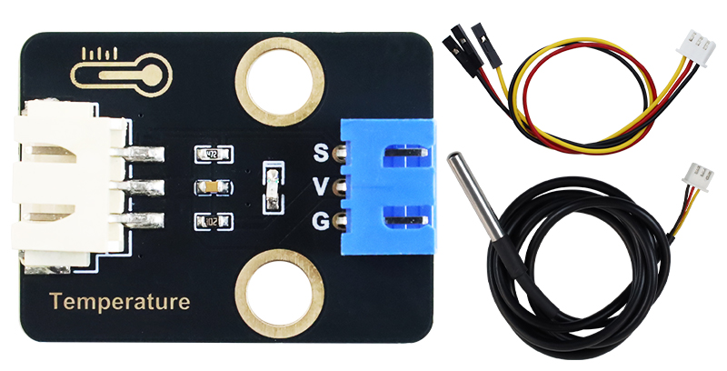
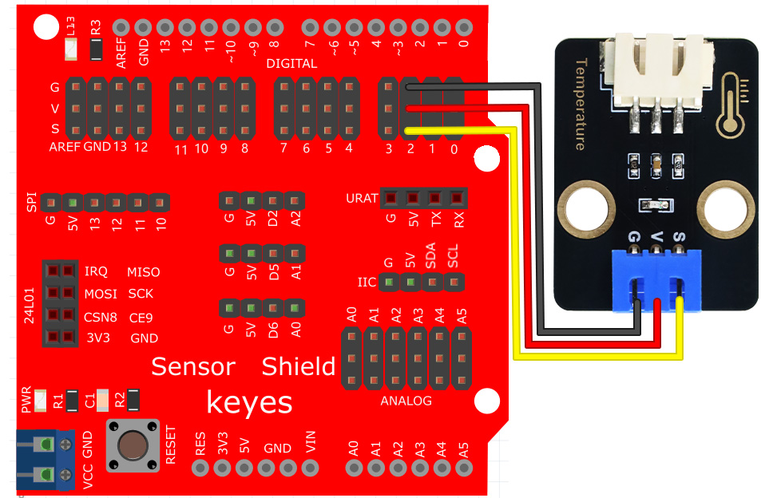
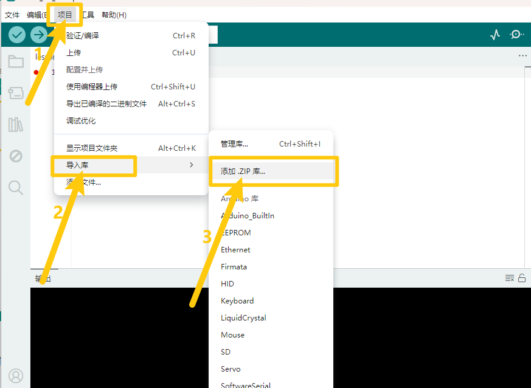
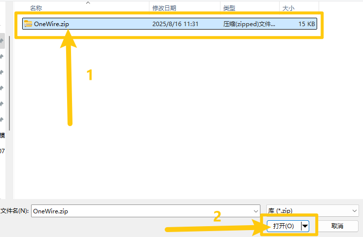
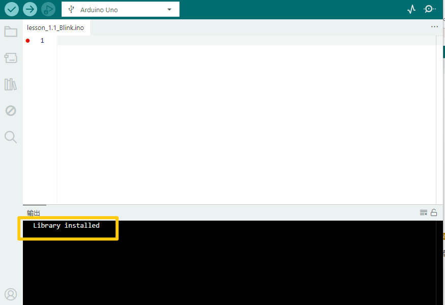
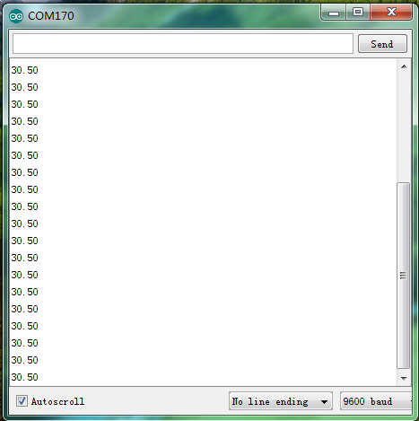

#  KE4094 Keyes STEM电子积木 DS18B20温度传感器 黑色环保（蓝色端子）




## 1. 介绍


KE4094 Keyes STEM电子积木 DS18B20温度传感器 黑色环保（蓝色端子），搭配 1 米长不锈钢防水探头，适配狭小空间布设，可直接浸入水中完成水温采集，广泛适用于水箱、管道、密闭容器等场景的温度监测。传感器采用单总线数字信号输出，通信稳定抗干扰，可挂载多路传感器在同一信号线上，兼容性极强，能够直连 Arduino 及各类主流主控器，接线便捷、适配性广，可快速搭建温度采集与温控系统


## 2. 规格参数


| 参数           | 值                 |
| -------------- | ------------------ |
| 工作电压       | 3.0-5.5V（DC）                  |
| 输出方式       | 单总线数字信号，9~12bit 分辨率可调|
| 测温范围       | -20℃ ~ +100℃                  |
| 接口       |3PIN 防反接 XH2.54 接口              |
| 重量       | 转接板 3.3g，整套（板 + 探头线）23.3g |


## 3. 工作原理

DS18B20 传感器基于半导体温敏特性工作。在不同温度下，芯片内部振荡器的振荡频率会随温度发生规律性变化。温度变化时，内部温敏元件的电参数随之改变，芯片将温度信息转换为对应的数字编码。
转换后的数字信号通过单总线协议输出，主控按照时序读取编码数据，再通过算法解析换算，最终得到对应的温度数值。

## 4. 接口描述


模块有3个引脚：
| 功能引脚 | 描述 |
| -- | -- |
| S | 单总线数字信号（连接开发板数字输入引脚） |
| V | 电源正极（3.0V-5.5V） |
| G | 电源负极（接地） |


## 5. 连接图


| KE4094模块引脚 | Arduino引脚 |
| -------------- | ----------- |
| VCC            | 5V / 3.3V   |
| GND            | GND         |
| S              | D2          |



DS18B20探头连接在另一侧。

## 6. Arduino

- 下载文件：[Arduino.7z](./media/Arduino.7z).


- 打开Arduino IDE，选择“项目”，选择“导入库”，再选择“添加.ZIP库”。

  

- 找到下载资料的存放位置，打开文件夹找到库文件，选择要导入的库，点击“打开”。

- 安装成功后出现的界面
  

```c++
#include <OneWire.h>  

int DS18S20_Pin = 2; // 定义数字口2  
OneWire ds(DS18S20_Pin);  

void setup(void) {  
    Serial.begin(9600); // 设置波特率  
}  

void loop() {  
    float temperature = getTemp(); // 调用函数计算温度值  
    Serial.println(temperature); // 显示温度值，并自动换行  
    delay(100); // 延迟0.1S   
}  

float getTemp() {  
    // returns the temperature from one DS18S20 in DEG Celsius  
    byte data[12];  
    byte addr[8];  

    if (!ds.search(addr)) {  
        // no more sensors on chain, reset search  
        ds.reset_search();  
        return -1000;  
    }  
    
    if (OneWire::crc8(addr, 7) != addr[7]) {  
        Serial.println("CRC is not valid!");  
        return -1000;  
    }  
    
    if ((addr[0] != 0x10) && (addr[0] != 0x28)) {  
        Serial.print("Device is not recognized");  
        return -1000;  
    }  

    ds.reset();  
    ds.select(addr);  
    ds.write(0x44, 1); // start conversion, with parasite power on at the end  
    byte present = ds.reset();  
    ds.select(addr);  
    ds.write(0xBE); // Read Scratchpad  

    for (int i = 0; i < 9; i++) { // we need 9 bytes  
        data[i] = ds.read();  
    }  

    ds.reset_search();  
    byte MSB = data[1];  
    byte LSB = data[0];  
    float tempRead = ((MSB << 8) | LSB); // using two's complement  
    float TemperatureSum = tempRead / 16;  
    return TemperatureSum;  
}  
```
按照上图接好线，烧录好代码，上电后，通电后，您可以在软件串口监视器中看到当前环境温度值，如下图所示。



